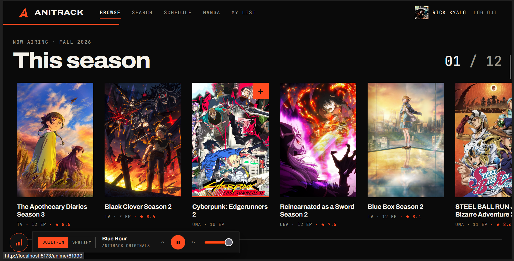

# AniTrack

A personal anime watchlist tracker, in the spirit of MyAnimeList. Search the
anime catalog, log what you're watching, rate and review, and see your stats.



## Stack

- **Frontend**: React 18 + Vite, React Router, plain CSS (no framework)
- **Backend**: Express + better-sqlite3
- **Auth**: JWT + bcrypt
- **Anime data**: [AniList GraphQL API](https://anilist.gitbook.io/anilist-apiv2-docs/) — no key required

Your own database only stores accounts and each user's list entries
(status, score, progress, reviews). Anime metadata (titles, covers,
synopses) is fetched live from AniList and cached briefly on the server.

## Project structure

```
anitrack/
  backend/     Express API (auth, list, anime proxy) + SQLite
  frontend/    React app (Vite)
```

## Running locally

### 1. Backend

```
cd backend
npm install
cp .env.example .env   # then edit JWT_SECRET
npm run dev
```

API runs on `http://localhost:5000`. SQLite file `anitrack.db` is created
automatically on first run.

### 2. Frontend

```
cd frontend
npm install
npm run dev
```

App runs on `http://localhost:5173` and proxies `/api` calls to the backend.

## Features

- Anime catalogue: search with genre filters, seasonal and top-rated lists, a weekly airing schedule, and a live countdown to the next episode
- Manga as its own section: trending and top-rated browse, search, detail pages and a separate list
- Personal lists with status, score, progress and private notes, for both anime and manga
- "Can't decide?" picker that chooses from your Plan-to list, plus a stats panel (status split, score spread, favourite genres, time watched)
- Ratings in 0.5 steps, plus optional detailed ratings (story, characters, visuals/art, music/pacing, enjoyment) next to the overall score
- Profile with photo, bio, public page, and favourites: a top 3 and a separate top 15 for anime, manga and characters
- Export a list as JSON or CSV, or both lists as one Excel workbook (an Anime sheet and a Manga sheet)
- Import from Excel (.xlsx), Word (.docx), CSV or JSON. Titles without an ID are matched against the catalogue, and you review the matches before anything is saved. Word files can use headings like "Completed" or "Plan to watch" to set statuses
- Background music player (three original loops, pause/skip/volume, remembers your choice). Swap in your own tracks in `frontend/public/music/playlist.json`
- Profile pages use a type mix: Fraunces for the name, bio and section titles, Archivo for numbers, JetBrains Mono for labels
- Backend: login rate limiting, security headers, input validation, one shared list router for anime and manga

## Front-end stack

React 18 + Vite, with Lenis (smooth scroll), GSAP + ScrollTrigger (animation, pinned scroll sections), and Vanta.js on three.js (interactive dot-field hero, lazy-loaded on desktop only). `three` is pinned to 0.134.0 because Vanta targets that release.

## Deploying (free)

The Express server also serves the built React app, so one web service runs everything.

1. Push the repo to GitHub.
2. On [Render](https://render.com): **New + > Blueprint**, pick this repo (it reads `render.yaml`).
   Or **New + > Web Service** with build command `npm run build`, start command `npm start`,
   and env vars `NODE_ENV=production` and a long random `JWT_SECRET`.
3. Open the URL Render gives you.

> **Heads up:** Render's free tier has an ephemeral filesystem and sleeps after 15 minutes idle,
> so the SQLite file is wiped when it restarts. Fine for a demo; for real data, move to a hosted
> database or a paid instance with a persistent disk (set `DB_PATH` to the disk path).

## API overview

| Method | Route              | Auth | Description                         |
|--------|---------------------|------|--------------------------------------|
| POST   | /api/auth/register  | —    | Create account, returns JWT          |
| POST   | /api/auth/login     | —    | Log in, returns JWT                  |
| GET    | /api/anime/search   | —    | Search anime (`?q=`)                 |
| GET    | /api/anime/top      | —    | Top-rated anime                      |
| GET    | /api/anime/season/now | —  | Currently airing season              |
| GET    | /api/anime/:id      | —    | Full detail for one title            |
| GET    | /api/list           | JWT  | Your list entries                    |
| GET    | /api/list/stats     | JWT  | Episode/score stats                  |
| POST   | /api/list           | JWT  | Add/update an entry                  |
| POST   | /api/list/resolve   | JWT  | Match up to 25 titles to catalogue IDs (same under /api/manga-list) |
| PATCH  | /api/list/:id       | JWT  | Update status/score/progress/review  |
| DELETE | /api/list/:id       | JWT  | Remove an entry                      |

## Next steps / ideas

- Reviews page showing all your written reviews
- Public profile pages (shareable list)
- Automatic retry on transient Jikan/MAL failures
- In future, add some manga option too- to also track manga read 
- Character and staff pages (Jikan supports these too)
- Rate-limit-aware request queue for Jikan (currently a simple 5-min cache)
