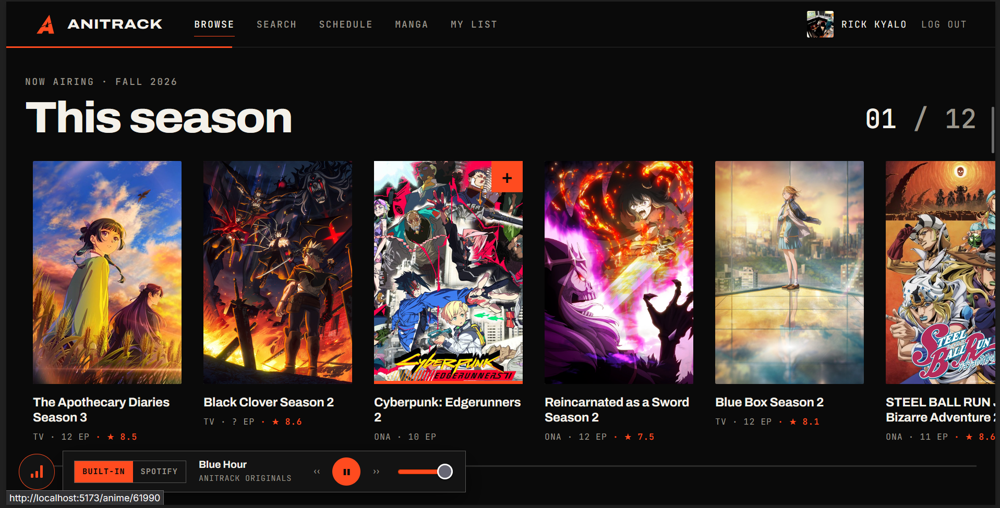
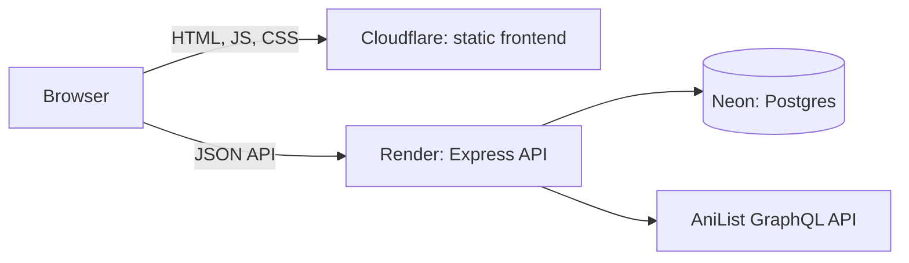

# AniTrack

An anime and manga tracker in the spirit of MyAnimeList. Search the catalogue, log what you're watching or
reading, rate and review, make ranked lists, and compare taste with friends.

**Live demo:** https://anitrack.muthokaricky.workers.dev
(The API sleeps on free hosting, so the first load after a quiet spell can take up to a minute. The app shows a
"Waking up the server" message while it wakes.)



## How it fits together



- **Frontend**: React 18 + Vite, React Router, plain CSS (no framework). Served from Cloudflare so it is always on.
- **Backend**: Express + PostgreSQL (Neon). JWT + bcrypt for accounts.
- **Catalogue data**: [AniList GraphQL API](https://anilist.gitbook.io/anilist-apiv2-docs/), no key required, cached briefly
  on the server, with a backup catalogue if AniList is down.

Your own database stores accounts, list entries (status, score, progress, dates, reviews), favourites and custom
lists. Titles, covers and synopses come live from AniList.

## Features

**Track**
- Anime and manga lists with status, score (0.5 steps), progress, notes, tags and optional detailed ratings
- Start and finish dates (filled in for you when you start and finish) and a rewatch / reread counter
- Weekly goal, streak, a year-long activity heatmap and a "days watched" total
- Live "Ep 8 in 2d 4h" countdowns on the shows you are watching, plus a weekly airing schedule
- On a phone: swipe a row right for +1, left to remove (with undo)

**Discover**
- Search with genre filters, seasonal and top-rated lists, and recommendations from your highest-rated titles
- "Where to watch" links on anime pages and "Read officially" links on manga pages (official sites only; AniTrack
  never hosts or embeds chapters or episodes)

**Lists and sharing**
- Custom lists of anime, manga and characters ("Top 10 arcs", "Top 10 villains"), ranked or not, with a note on
  each entry. The same title can appear more than once, so one show can fill several arc slots
- Private by default; make a list public and share the link. Public lists appear on your profile
- Discover page for other people's public lists, with "Save a copy"
- Download a list as a poster image (the note becomes the caption: *Marineford*, with *One Piece* underneath) or as text
- Profile with photo, bio and favourites (top 3 and top 15 for anime, manga and characters), a public page, and a
  taste match against any public profile (see below)
- Wrapped: a yearly summary you can download as an image

**Import and export**
- Import from MyAnimeList (`.xml` or `.xml.gz`), an AniList username (public lists), Excel, Word, CSV or JSON.
  Titles are matched against the catalogue and you review the matches before anything is saved. Covers, genres,
  dates and rewatch counts come across where the source has them
- Export a list as JSON or CSV, or both lists as one Excel workbook

**Under the hood**
- Free-tier friendly: a waking-server banner with automatic retries for reads, and an always-on static frontend
- Login rate limiting, security headers, input validation, one shared list router for anime and manga
- Link previews (Open Graph tags) so shared links look right in chat apps

### Rick's Algorithm (the taste match)

A hand-built weighted formula, not machine learning. It compares two people four ways and scores each from
0 to 100%:

1. **Genres** you lean towards (cosine similarity of score-weighted genre profiles)
2. **How you rate** the titles you both scored (average gap between scores)
3. **Titles** you both have (overlap of the two lists)
4. **Favourites** you share

The final percentage is a weighted average of whichever parts can be measured. If one of you has no list yet, it
falls back to favourites alone. The code is in `backend/src/taste.js`, with tests.

## Project structure

```
anitrack/
  backend/     Express API (auth, lists, custom lists, imports, anime proxy) + Postgres
  frontend/    React app (Vite)
  docs/        Case study
```

## Running locally

### 1. Backend

```
cd backend
npm install
cp .env.example .env   # then set JWT_SECRET and DATABASE_URL (your Neon connection string)
npm run dev
```

The API runs on `http://localhost:5000`. Tables are created and upgraded automatically on start.

### 2. Frontend

```
cd frontend
npm install
npm run dev
```

The app runs on `http://localhost:5173` and proxies `/api` calls to the backend.

### Tests

```
cd backend && node --test                       # 136 tests: validation, taste match, imports, SQL-free logic
cd frontend && node --test src/lib/*.test.js    # 35 tests: importers, heatmap, swipe, countdown, card drawing
```

The route handlers that run SQL are not covered yet: that needs a real Postgres in CI (see "Next steps").

## Deploying (free)

**Option A: one service.** The Express server also serves the built React app.

1. Push the repo to GitHub.
2. On [Render](https://render.com): **New + > Blueprint**, pick this repo (it reads `render.yaml`).
3. Add `DATABASE_URL` (your Neon connection string). Data lives in Neon, so it survives restarts and deploys.

**Option B: split (how the live demo runs).** The frontend sits on Cloudflare so it is always on, and only the
API sleeps.

1. Deploy the API on Render as above, and set `CORS_ORIGIN` to the frontend's address (no trailing slash).
2. On Cloudflare (Workers static assets), connect the repo with root directory `frontend`, build command
   `npm install && npm run build`, deploy command `npx wrangler deploy`, and the build variable `VITE_API_URL`
   set to the Render address (no trailing slash, no `/api`). `frontend/wrangler.jsonc` serves the built `dist`
   folder as a single-page app.

> Render's free tier sleeps after 15 minutes idle, and Neon pauses an idle database. The first request after a
> nap is slow; the app handles that with a banner and automatic retries.

## API overview

| Method | Route                              | Auth | Description                                         |
|--------|-------------------------------------|------|------------------------------------------------------|
| POST   | /api/auth/register                  | none | Create account, returns JWT                          |
| POST   | /api/auth/login                     | none | Log in, returns JWT                                  |
| GET    | /api/anime/search                   | none | Search anime (`?q=`)                                 |
| GET    | /api/anime/top                      | none | Top-rated anime                                      |
| GET    | /api/anime/season/now               | none | Currently airing season                              |
| GET    | /api/anime/batch?ids=1,2,3          | none | Details for up to 50 MyAnimeList ids (same under /api/manga) |
| GET    | /api/anime/airing                   | JWT  | Next episodes for your watching/plan titles          |
| GET    | /api/anime/for-you                  | JWT  | Recommendations from your top-rated titles           |
| GET    | /api/anime/:id                      | none | Full detail, including where-to-watch links          |
| GET    | /api/users/:username/match          | JWT  | Taste match with a public profile                    |
| GET    | /api/list                           | JWT  | Your list entries (same under /api/manga-list)       |
| GET    | /api/list/stats                     | JWT  | Episode and score stats                              |
| POST   | /api/list                           | JWT  | Add or update an entry                               |
| PATCH  | /api/list/:id                       | JWT  | Update status, score, progress, dates, review        |
| DELETE | /api/list/:id                       | JWT  | Remove an entry                                      |
| POST   | /api/list/import                    | JWT  | Bulk import up to 3000 entries                       |
| GET    | /api/import/anilist                 | JWT  | Fetch a public AniList user's list (`?username=&kind=`) |
| GET    | /api/custom-lists                   | JWT  | Your custom lists                                    |
| POST   | /api/custom-lists                   | JWT  | Create a custom list                                 |
| GET    | /api/custom-lists/discover          | none | Popular public lists                                 |
| GET    | /api/custom-lists/:id               | opt. | One list (public, or yours)                          |
| PUT    | /api/custom-lists/:id               | JWT  | Edit a list or replace its entries                   |
| POST   | /api/custom-lists/:id/items         | JWT  | Add one entry to a list                              |
| POST   | /api/custom-lists/:id/copy          | JWT  | Save a copy of a public list                         |
| GET    | /api/custom-lists/user/:username    | none | A person's public lists (public profiles only)       |
| GET    | /api/img?url=                       | none | Allowlisted image proxy (used when drawing cards)    |

## Next steps

- Continuous integration: run the tests and a build on every push, with a Postgres service so the SQL routes are tested too
- Per-list link previews (a small Cloudflare Worker that adds the list's title and cover to the page for chat apps)
- Push notifications for new episodes
- Character pages, and an "Add to list" button for characters
- Keyboard shortcuts on desktop
